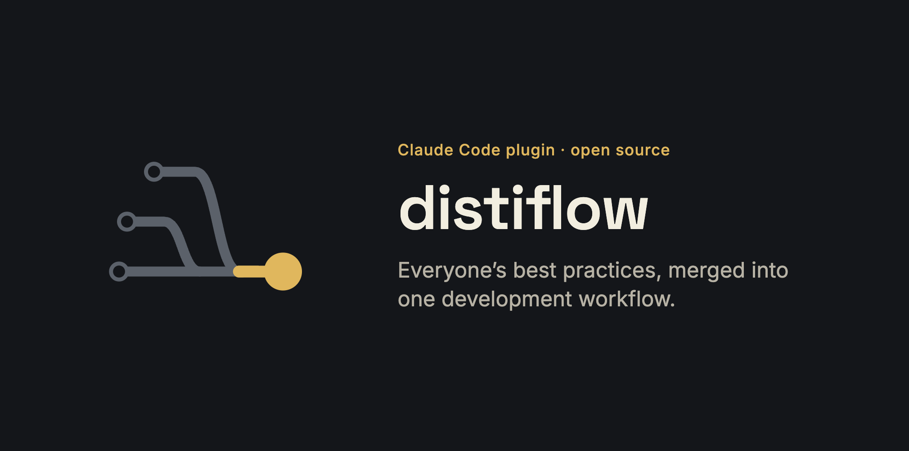
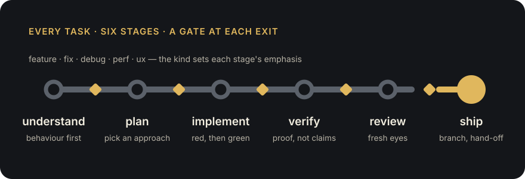
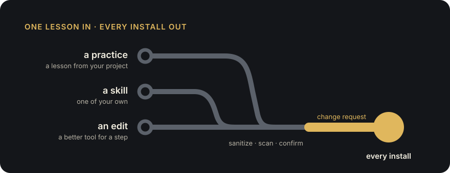
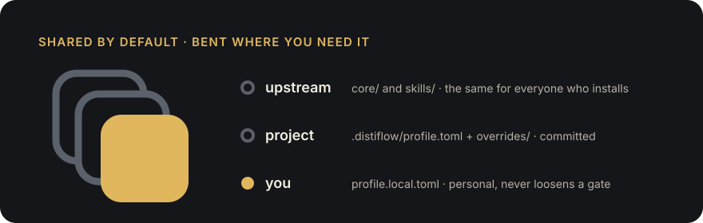
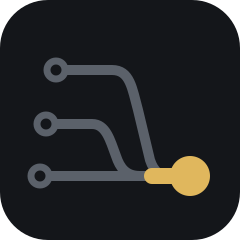

<p align="center">
  
</p>

<p align="center">
  
  
  
  
  
</p>

<p align="center">
  <strong>Your team's best habits, in every Claude Code session.</strong><br>
  Six stages, gates that need evidence, and one command to share what you learned.
</p>

<p align="center">
  <a href="#install">Install</a> &middot;
  <a href="#how-a-task-runs">How a task runs</a> &middot;
  <a href="#everyones-best-practices-merged">Share a lesson</a> &middot;
  <a href="#bend-it-to-your-project">Bend it</a> &middot;
  <a href="#commands">Commands</a>
</p>

---

Everyone who works with Claude Code builds up tricks. One person always reproduces a bug before
touching it. Another found that the Chrome extension checks a UI for a fraction of the tokens.
A third has a skill that makes every decision name three real options. Those tricks live in
personal notes and private skill folders, and they leave with the person.

distiflow merges them into one workflow that everyone runs. When one person learns something,
they send it upstream with `/distiflow:contribute`. Once merged, every install has it.

## Install

```
/plugin marketplace add distiflow/distiflow
/plugin install distiflow@distiflow
```

Then, in your project:

```
/distiflow:init
/distiflow:task fix the login redirect loses the return url
```

Needs Python 3.11 or newer and git. `gh` is needed only to send contributions.

## How a task runs

<p align="center">
  
</p>

Every task walks the same six stages. The task's kind (feature, fix, debug, perf or ux) sets the
emphasis: a fix reproduces first, a perf task measures a baseline, a ux task walks the journeys in
the running app.

- **Practices load by tag.** Each stage loads only the practices that match the stage, the kind and
  the project's signals (tests, UI, migrations, CI…), within a token budget per stage.
- **Gates need evidence.** A stage ends with `distiflow gate pass <id> <gate> --evidence …`. No
  evidence, no next stage.
- **Tasks survive sessions.** State lives in `.distiflow/tasks/<id>/`. One session holds a task at a
  time, and any later session picks it up with `/distiflow:task resume <id>`.
- **Work happens in its own copy.** The implement stage works in `<repo>.distiflow/<id>/`, so your
  checkout stays clean.

## Everyone's best practices, merged

<p align="center">
  
</p>

Three ways in, one way out:

```
/distiflow:contribute always reproduce before fixing          # a new practice
/distiflow:contribute --skill ~/.claude/skills/my-skill       # one of your own skills
/distiflow:contribute --edit core/stages/review.md            # a better tool for a step
```

Every contribution goes through the same steps before it leaves your machine:

1. **Sanitize.** Your project's own words are replaced with the shared glossary terms.
2. **Scan.** Secrets, emails, hosts, IP addresses, your project's deny-terms and harmful
   instructions (piping curl into a shell, reading credentials, getting around a gate) block the send.
3. **Confirm.** You see the diff and the most similar existing entries, then choose: new, extends
   or duplicate.
4. **Send.** Exactly the confirmed bytes go up as one change request. If the file changed upstream
   in the meantime, the send stops instead of overwriting someone else's work.

Shared skills show up for everyone as `/distiflow:<name>`, in every session. Claude also uses a skill
on its own when its description fits the task.

## Bend it to your project

<p align="center">
  
</p>

The upstream workflow is the default. A project can bend any stage, practice or limit with
`/distiflow:override <path>`. This copies the file into `.distiflow/overrides/` and records which
upstream version it came from, so later upstream changes show up as drift. Your personal
`profile.local.toml` changes your own settings, but it cannot change gates.

Found that your override is better for everyone? `/distiflow:contribute --edit` starts from it.

## Commands

| Slash command | What it does |
|---|---|
| `/distiflow:init` | Propose a project profile and write it after you confirm each part |
| `/distiflow:task <kind?> <description>` | Start a task (kinds: feature, fix, debug, perf, ux) |
| `/distiflow:task resume <id>` · `list` · `abandon <id>` | Continue, list or drop tasks |
| `/distiflow:override <path>` | Make a local override of an upstream stage, practice or TOML file |
| `/distiflow:contribute <idea>` | Send a generic practice upstream as a change request |
| `/distiflow:contribute --skill <dir>` | Share one of your skills; once merged, every install has it as `/distiflow:<name>` |
| `/distiflow:contribute --edit <path>` | Propose a change to an upstream stage, practice or shared skill, such as a better tool for a step |

The CLI behind them is `distiflow` (`bin/distiflow`): `task`, `note`, `gate pass`, `advance`,
`stage reopen`, `ship`, `worktree restore`, `brief`, `profile check`, `override`, `init`, `contrib`,
`check`, `scan`. Exit codes: 0 ok, 1 refused, 2 needs confirmation, 3 environment missing.

<details>
<summary><strong>What's inside: 19 practices across five stages</strong></summary>

<br>

| Stage | Practices |
|---|---|
| understand | behaviour-before-architecture · cost-levers · debug-by-reading-errors · grill-the-request · perf-baseline-first · reproduce-before-fixing · subagent-budget · ux-journeys-first |
| plan | choose-an-approach · phase-sizing · risk-driven-test-design |
| implement | red-evidence-before-commit · session-grouping |
| verify | perf-before-after · regression-test-for-fix · run-the-gates · ux-running-app-check |
| review | defect-classes · spec-review |

Each one is a short Markdown file in `core/practices/<stage>/` with TOML frontmatter that says when it
loads. Read them, override them, or send a better one.

</details>

<details>
<summary><strong>What distiflow writes in your project</strong></summary>

<br>

```
.distiflow/
  profile.toml          committed project profile (signals, commands, git, glossary, gates)
  profile.local.toml    personal layer, ignored by git; cannot change gates
  overrides/            local copies of upstream files, each recording the upstream hash
  practices/            project-only practices
  tasks/<id>/           task state, claim, brief snapshots, spec, plan, reviews (ignored)
  contrib/<slug>/       contribution drafts (ignored)
<repo>.distiflow/<id>/  the working copy of a task in the implement stage
```

distiflow writes only inside `.distiflow/`, `<repo>.distiflow/` and `~/.distiflow/upstream`.

</details>

## License

MIT

<p align="center">
  <br>
  
  <br>
  <sub>Your best practice is one <code>/distiflow:contribute</code> away.</sub>
</p>
